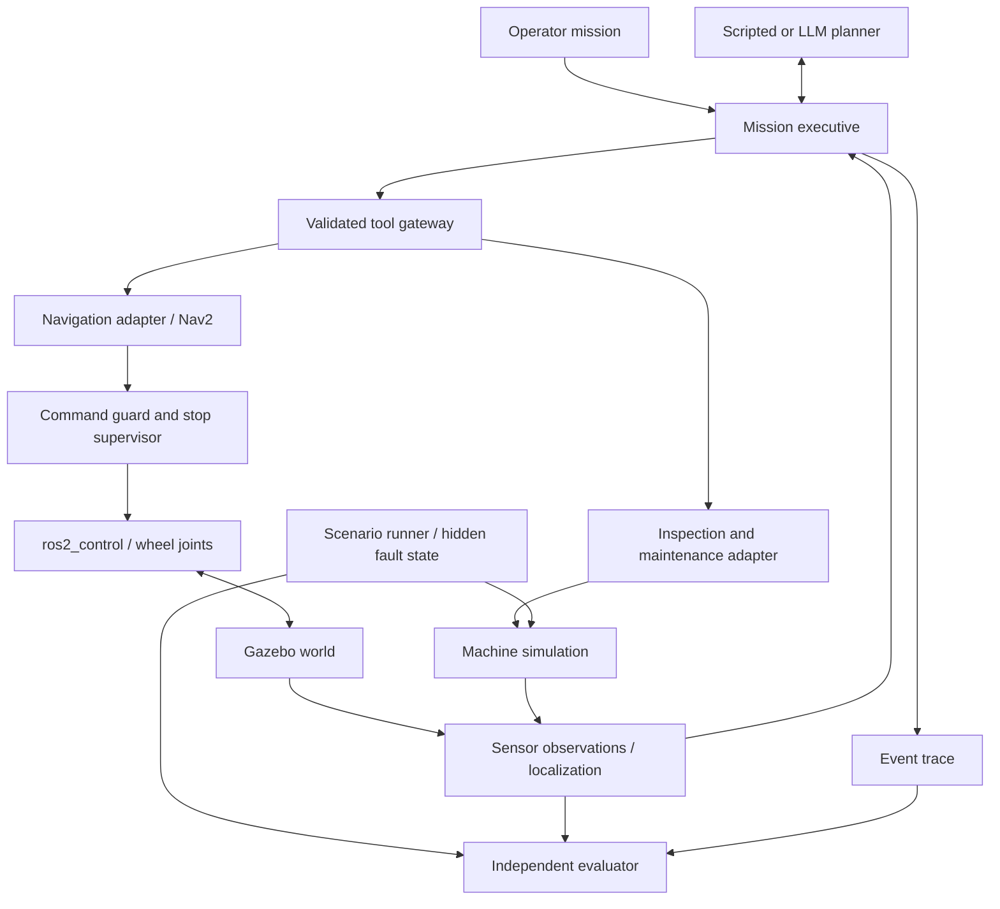

# Architecture — design v0.1

Status: target architecture with an implemented passive sensor slice; see STATUS.md for measured coverage. Updated 2026-10-24.

## Product boundary

An embodied maintenance agent investigates a power anomaly in a simulated station room. The first demonstration must show a causal chain: observation → diagnosis → safe intervention → measured recovery. A conversational claim of success is insufficient.

MVP: one differential-drive robot, a known floor map, three machines, RGB camera, 2D lidar, IMU, encoders and local machine telemetry. The station has artificial gravity; microgravity dynamics are out of scope. Machine controls are proximity-gated simulated interactions, not physically manipulated buttons. An arm and contact-based repair follow later.

## System structure

The planner is outside the ROS graph and has access only to the tool gateway. Hidden scenario files and evaluator truth must not be mounted into its process. ROS namespaces alone are not an access-control boundary. In the initial single-user simulation, process/container isolation and an explicit gateway implement this separation; untrusted remote access is not part of the MVP.

## Proposed stack and portability

Selected target: existing ARM64 Thor on Ubuntu 24.04.3, ROS 2 Jazzy, Gazebo Harmonic, ros_gz and gz_ros2_control. The initial amd64 proposal was superseded by the user-selected host. Ogre1/llvmpipe is the measured rendering path; Ogre2 crashed during startup. Use Nav2 for navigation with a supplied map and AMCL localization; exploration/SLAM is a later feature. Python is the default for mission logic, telemetry and evaluation; use C++ only where simulator integration or measured performance requires it. Standard ROS packages own wheel control and navigation.

This is a compatible baseline, not a claim that it is the newest stack. Exact package versions and container digest must be recorded after the host smoke test. Mac is an editing/operator host; Linux simulation may run in a VM or on an existing Linux machine only after camera rendering and sensor performance are measured. The user subsequently authorized this Thor simulation setup. No GPU purchase or cloud rental is part of the implementation.

The simulated onboard computer initially exposes latency, memory/budget and failure constraints. It does not emulate an AI chip electrically. LLM inference can be local or through a provider adapter; hosted inference is an explicit configuration choice with data and spending limits.

Sources checked 2026-10-24:
- [Official ROS/Gazebo pairings](https://github.com/gazebosim/docs/blob/master/common/ros_installation.md)
- [Gazebo Harmonic platforms](https://gazebosim.org/docs/harmonic/install/)
- [Jazzy gz_ros2_control](https://control.ros.org/jazzy/doc/gz_ros2_control/doc/index.html)

## Proposed repository packages

| Package / directory | Responsibility |
| --- | --- |
| orbital_description | Robot URDF/Xacro, inertial and joint limits, meshes |
| orbital_sim | Room SDF, machine dynamics, controls and fault injection |
| orbital_bringup | Launch, simulation clock, controller and navigation configuration |
| orbital_interfaces | Versioned observation, action and result messages |
| orbital_safety | Final velocity guard, watchdog, interlocks and stop latch |
| orbital_mission | Executive, gateway, scripted baseline and planner adapters |
| orbital_evaluation | Scenario seeds, independent scoring and trace checks |
| scenarios/ | Versioned scenario specifications; hidden values withheld from planner |

These are planned packages; empty code packages should not be created just to match this table.

## Runtime ownership

Gazebo owns physical state. The machine model owns machine state transitions. The mission executive owns one active mission, action sequencing and its append-only event trace. Navigation owns path execution. The safety supervisor is the only source accepted by the base's command input; all teleoperation and autonomous commands pass through it. Machine operations independently check their preconditions at execution time.

States: IDLE → OBSERVING → DIAGNOSING → NAVIGATING → INTERVENING → VERIFYING → SUCCEEDED. Any active state can enter STOPPING, FAILED or ESCALATED. Navigation/action failures return typed results for bounded replanning. The executive, not the language model, enforces attempt limits and terminal states.

## Time, sensing and transforms

Use simulation time for sensor stamps, dynamics and evaluation. Use monotonic wall time for provider deadlines and process watchdogs so a paused simulator cannot leave a live action waiting indefinitely. Pausing stops actuation; resetting the world invalidates pending actions and starts a new run_id.

Define map → odom → base_footprint → base_link → sensor frames with exactly one publisher per transform. Reject stale, future or wrong-run observations; expose age and validity to the planner. Sensor data uses bounded queues; action results and machine commands use reliable delivery. Choose concrete ROS QoS profiles during integration and test publisher/subscriber compatibility.

Initial tuning targets, subject to host measurement: wheel control 50 Hz, lidar 10 Hz, RGB 5 Hz, machine telemetry 2 Hz. LLM calls are event-driven, never part of a control deadline. Sensor fidelity and real-time factor must be measured before increasing visual detail.

## Safety and failure behavior

- One mutating action at a time, with a deadline, cancellation and unique action ID.
- Missing command heartbeat stops the base; restarting a process never resumes a previous motion automatically.
- Stop cancels navigation, zeros the command and latches until an explicit operator reset. Verify physical stopping distance rather than assuming zero command means instant stop.
- Maintenance requires the correct machine, permitted control, stationary robot, proximity and fresh telemetry. Reset requires power isolation; restore requires a healthy post-reset check.
- Duplicate action IDs return the stored result; they do not repeat an intervention. Old run IDs are rejected.
- Invalid model output, provider timeout or budget exhaustion leads to a bounded retry or safe escalation.
- Machine labels and camera text are observations, never executable instructions. No shell, arbitrary ROS publication or unrestricted filesystem tools are exposed to the runtime planner.

## Persistence and operator view

Each run records run_id, scenario/version/seed, software versions, planner/model identifier, timestamps, tool requests/results and evaluator verdict. Store artifacts outside Git. Redact credentials; do not log provider authorization headers. Save selected simulated frames only when useful to reproduce a diagnosis.

First operator view: simulator window plus a structured mission timeline showing observations, chosen action and measured outcome. A web dashboard is deferred until the first end-to-end run works. Do not store private chain-of-thought; store concise evidence-linked decisions.
